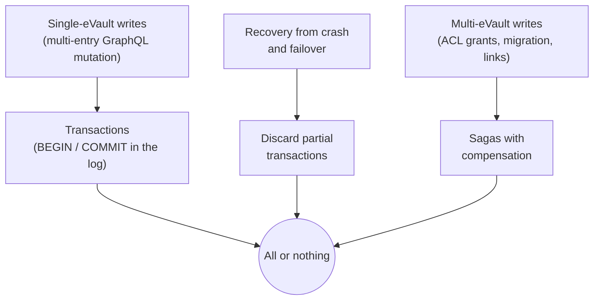

# Atomicity

Atomicity is the **A** in ACID. It is the rule that a change is either fully
recorded or not recorded at all — never half-recorded. Inside a single
[eVault](/docs/Infrastructure/eVault) it keeps multi-part writes from leaving
the store in an in-between state. Across multiple eVaults, where one user's
action touches another user's data, it is the harder problem this section
also has to address.

> **In plain terms**
>
> When you save something that touches several pieces of data at once, the
> eVault treats the whole save as one event. Either every piece lands together
> or none of them do, even if the power goes out halfway through. You never
> see a half-saved state, and nothing you were told was saved can later turn
> out to have only partly happened.

## Why eVaults need atomicity

The eVault's GraphQL surface looks like single-call operations, but underneath
many of them are multi-step:

- `createMetaEnvelope` writes one MetaEnvelope node **and** one Envelope node
  per field; updating it can touch several fields at once.
- `bulkCreateMetaEnvelopes` writes many MetaEnvelopes in one request, each of
  which itself spans multiple nodes.
- An ACL change rewrites a single field but has system-wide consequences
  (webhook routing, access decisions, future read paths).
- A binding-document mutation writes the document plus its initial signature,
  and either is meaningless without the other.

Without atomicity, a crash mid-write could leave a MetaEnvelope with half its
Envelopes attached, or an ACL change that updated for some readers and not
others. Either is a worse failure mode than the write being lost entirely:
losing a write is a known, recoverable state; partial state is silent
corruption that propagates through every downstream system.

## The shape of an atomic change

This section covers three layers of atomicity, each on its own page:

- **[Transactions](transactions)** — every multi-entry change is bracketed in
  the [Write-Ahead Log](/docs/architecture/redundant-evaults/durability) by a
  `BEGIN` marker and a signed `COMMIT` marker. The commit marker is the
  single piece of state that decides whether the change happened or not.
- **[Recovery](recovery)** — when an eVault restarts after a crash, or an old
  primary [rejoins](/docs/architecture/redundant-evaults/failover/#the-old-primary-rejoins)
  after a failover, any transaction whose commit marker is missing is dropped
  wholesale. Partial transactions never become visible.
- **[Cross-eVault atomicity](cross-evault)** — when one action touches several
  eVaults at once (for example granting another user access to a
  MetaEnvelope, or moving data between providers), atomicity inside any
  single eVault is not enough. This page covers the saga-style coordination
  that gets the same all-or-nothing guarantee at the system level.

## What sits behind atomicity

Atomicity is a property of the
[eVault's log](/docs/architecture/redundant-evaults/durability), not of any
single component. The same machinery that makes the log durable makes it
atomic — the commit marker is just another log entry, and the rule that the
acknowledgement only goes out after the commit marker is durable is the same
rule that makes saved-means-saved. This is why this section sits next to
[Redundant eVaults](/docs/architecture/redundant-evaults) in the architecture:
the two depend on the same underlying log discipline, but they serve
different goals.

## Where atomicity stops

Atomicity is a property of state changes **inside an eVault and across the
eVaults the change touches**. It is not a property of the wider system. In
particular:

- **Webhook delivery is not atomic with the write.** The
  [Awareness Protocol](/docs/W3DS%20Protocol/Awareness-Protocol) notification
  fires after the change commits. A webhook can be retried, dropped, or
  arrive late; the underlying state is still consistent.
- **Platform-side state is not atomic with the eVault.** A platform that
  caches a MetaEnvelope is on its own for keeping that cache in sync once the
  webhook arrives.
- **External systems are not atomic with anything.** An eVault write that
  triggers a payment, an email, or a third-party API call cannot be undone
  by the eVault if the external system has already moved on.

The [Cross-eVault](cross-evault) page covers the design's answer to these
limits: events fire from the final, committed state, never from in-progress
state, so consumers see one consistent picture even if their delivery is
late.

## Related sections

- [Durability](/docs/architecture/redundant-evaults/durability) — the
  Write-Ahead Log that atomicity is built on.
- [Consistency](/docs/architecture/consistency) — the **C** in ACID, the
  parallel property to this one.
- [Failover](/docs/architecture/redundant-evaults/failover) — how recovery
  preserves atomicity across leader changes.
