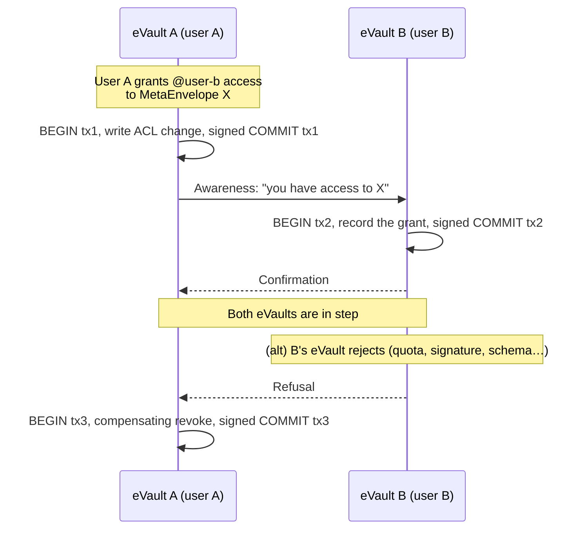

# Cross-eVault atomicity

Atomicity inside a single eVault is the local problem. The harder problem is
what happens when one client action touches **several** eVaults at once. Each
eVault is an independent system, run by an independent provider, with its own
[Write-Ahead Log](/docs/architecture/redundant-evaults/durability). The
local [transaction discipline](transactions) cannot stretch across that
boundary directly. This page covers what does.

> **In plain terms**
>
> If you do something that changes data in your eVault and someone else's at
> the same time — for example, you give a friend access to one of your
> records — both eVaults need to end up in step. Either both record the
> change or neither does; nothing in between. The system gets there by
> committing each side as its own atomic transaction and then handling the
> rare case where one side accepts and the other refuses, by reversing the
> accepted side.

## When one write touches more than one eVault

Most eVault writes are self-contained: the user's own data, the user's own
log, the user's own replicas. A handful of operations cross the boundary:

- **ACL grants.** When user A's MetaEnvelope lists `@user-b.w3id` in its
  ACL, user B's eVault has to know — both to expose the record on B's read
  side and to fire awareness webhooks to B's platforms.
- **Links.** A reference from one MetaEnvelope to another (across eVaults)
  needs the target's W3ID to resolve and the target's existence to be
  knowable to the source.
- **Migration.** Moving a user's data from eVault X to eVault Y (see
  [the transfer flow](/docs/architecture/identifiers/lifecycle#transferring-to-a-new-evault))
  is a long-running batch write across the two stores.
- **Binding documents that name a counterparty.** The owner's signature is
  written to one eVault, the counterparty's signature to another, and they
  belong together.

In each of these cases, a per-eVault atomic transaction is necessary but
not sufficient. Atomicity has to hold at the **multi-eVault** level too, or
clients can see one side of the change without the other.

## Why two-phase commit isn't the answer

The textbook solution is two-phase commit (2PC):

1. Phase 1 — each participating eVault writes the transaction's `BEGIN` and
   change entries, then locks them in a "prepared" state, and votes
   yes/no.
2. Phase 2 — a coordinator collects votes; if all yes, broadcast `COMMIT` to
   every participant; if any no, broadcast `ABORT`.

For an eVault network this is the wrong shape:

- **Blocking.** A prepared transaction holds locks on the participants until
  the coordinator decides. If the coordinator stalls — or any single
  participant is slow — the whole transaction blocks every other write that
  touches the same data.
- **Trust assumptions.** 2PC assumes the coordinator and participants are
  cooperative. eVault providers are independent and not assumed to
  cooperate.
- **Tail latency.** Even when nothing fails, every cross-eVault write pays
  two network round trips across providers that may be slow or geographically
  distant.

The eVault network has no central coordinator and treats providers as
mutually untrusting peers, so 2PC's preconditions are simply absent.

## The saga shape

The pragmatic answer is a **saga**: each eVault commits its local change as
a normal atomic transaction, and the participants compensate if a downstream
participant refuses. Sagas are the standard pattern for atomicity in
loosely-coupled distributed systems (introduced for long-lived transactions
by [Hector Garcia-Molina](https://www.cs.cornell.edu/andru/cs711/2002fa/reading/sagas.pdf),
now widespread in microservices).

Each numbered transaction inside a single eVault is fully atomic in the
[transactions](transactions) sense. The saga itself is atomic at the higher
level: clients of either eVault eventually see a state where both sides
agree, never one where only one side made a change.

## Compensation

When the second eVault refuses, the first eVault has to undo the change it
already committed. The undo is **also a transaction** — it appears in the
log, it is replicated, it is durable. Two consequences:

- **Compensation is visible.** Auditors can see "A granted access, B
  refused, A revoked." There is no quiet rollback that pretends the original
  grant never happened.
- **Compensation must be possible.** The eVault only emits a saga when the
  effect on either side has a defined inverse. ACL grants compose with ACL
  revokes; binding-document writes compose with deletes. Writes whose
  effects cannot be cleanly reversed — for example webhook deliveries to
  platforms — are not part of the saga. They are emitted by whichever side
  reaches the final committed state, so they fire from the final state, not
  from an in-progress one.

## When compensation is impossible

Some effects cannot be undone:

- **Awareness webhooks** that have already left for platforms.
- **External side effects** triggered by a platform receiving a webhook (a
  payment, an email, a record in a third-party system).
- **Reads that returned the in-progress state** to a client.

The design avoids these the same way: nothing externally visible is allowed
to fire until both sides of the saga have committed. Webhooks for a
cross-eVault transaction wait for the confirmation hop; reads on either side
that would expose the partial state are blocked until either commit or
compensation lands. The boundary is "atomicity at the eVault network's
edge" — within the network, sagas absorb the inconsistency; at the edge,
consumers always see one final state.

## What this gives you

Combining the local and cross-eVault layers:

- A single-eVault write either fully lands or never appears — by
  [transactions](transactions) and [recovery](recovery).
- A multi-eVault write either fully lands on every involved eVault, or every
  involved eVault observes a compensation that returns it to the pre-write
  state — by sagas with explicit compensation transactions.
- Externally-visible effects (webhooks, reads) fire from the final state of
  the network, never from a mid-saga state.

The cost is that cross-eVault writes are **eventually atomic** rather than
instantly atomic: there is a brief window between the first eVault's commit
and the second's confirmation during which an internal observer might see
one side ahead of the other. The design treats that window as a property
of the network and hides it from clients, who only see the committed final
state.

## Related work

- The [Saga pattern](https://www.cs.cornell.edu/andru/cs711/2002fa/reading/sagas.pdf)
  is the classical reference; the eVault implementation is a small
  specialisation with signed log entries on each side.
- Spanner uses true 2PC because Google controls every participant; eVaults
  cannot make that assumption.
- Event-sourced microservices use sagas for the same reason: independent
  services, no shared coordinator, atomicity required at the user-visible
  level.

The eVault inherits the saga pattern's strengths (no blocking, no central
coordinator, works across mutually untrusting parties) and the trade-offs
(eventual consistency on the multi-eVault boundary, compensations as
first-class operations).
