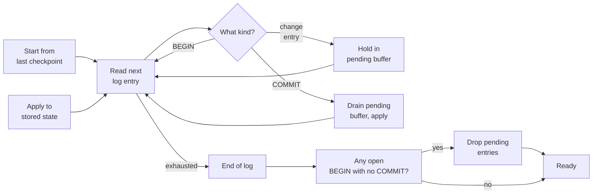

# Recovery and rollback

Recovery is the moment when atomicity stops being theoretical. Anything the
[transaction discipline](transactions) bought has to be enforced again when
the eVault restarts after a crash, when a replica is replayed, or when an
old primary [rejoins](/docs/architecture/redundant-evaults/failover/#the-old-primary-rejoins)
after a failover. The rule is the same in all three cases: a transaction
without a durable `COMMIT` is not a transaction.

> **In plain terms**
>
> When the eVault wakes up after a crash, it does not blindly continue from
> where it stopped. It re-reads its log, finds any transaction that started
> but never finished, and pretends it never happened. Nothing the client was
> told was saved is in that discarded tail, so nothing the client cares about
> is lost.

## The recovery scan

When an eVault starts up — or rather any time it has to compute its state
from the log — it walks forward from the last checkpoint and decides what to
do with each entry:

Two properties fall out of this walk:

- **No half-applied transaction is ever in the store.** Change entries don't
  touch the store until their commit lands; if the commit never lands, they
  never touch the store.
- **Every committed transaction is applied exactly once.** The hash chain
  inside the commit marker fixes which change entries belong to the
  transaction, so even if the walk runs twice (idempotent restart), the
  second pass produces the same result.

## What "drop" actually means

A dropped transaction does not vanish from the log. The change entries and
the `BEGIN` marker stay on disk as part of the immutable log record — this
matters for audit, because someone investigating later wants to see "the
primary tried to do X but never committed it" rather than a gap. The drop
is a property of the **apply** step, not the log itself.

When the log is later compacted (entries before a checkpoint can be
garbage-collected), the dropped tail's entries go away with everything else.
The hash chain keeps its integrity across the compaction because the chain
is anchored to checkpoint hashes, not to specific entries.

## Failover-time rewind

The crash case is one node restarting against its own log. The
[failover](/docs/architecture/redundant-evaults/failover) case is different:
an old primary rejoins after the rest of the replica set has moved on, and
its log has a **divergent tail** of entries the new primary never produced.
Under the asynchronous write mode that tail can include entries the old
primary acknowledged to clients but never streamed elsewhere.

Atomicity holds across the rewind too:

- The rewind finds the first divergent entry by walking the hash chain (see
  [Durability](/docs/architecture/redundant-evaults/durability/#making-the-log-trustworthy-across-independent-providers)).
- Everything after that point on the old primary's log is dropped, **in
  one go**. Half-committed transactions cannot survive because the rewind
  cannot pick and choose entries from the divergent tail.
- The rejoining node then streams the new primary's log from the divergence
  point forward, applying transactions through the same gate as any other
  replica.

The danger this avoids is subtle: without atomic rewind, you could end up
with a replica that has the `BEGIN` of a transaction and one of its change
entries from its own old log, plus the `COMMIT` of an unrelated transaction
from the new primary. The hash chain alone would catch this, but the
"discard the whole tail" rule makes the situation impossible in the first
place.

## What the client sees

The client's view of atomicity is symmetric:

- **Acknowledged write** → the `COMMIT` was durable somewhere when the
  acknowledgement went out, so recovery will keep it. Re-reading after the
  crash returns the new state.
- **Timed-out write** → the client does not know whether the `COMMIT` was
  durable. The transaction either survived recovery or was dropped; the
  client retries, and the retry either re-applies the transaction (if the
  original was dropped) or is a no-op (if the original survived, because
  the retry has the same idempotency key).

Idempotency keys on the GraphQL mutation surface give the client a clean
"retry is safe" guarantee. Without them, a client that retries after a
network blip risks producing the same write twice on top of a transaction
that did commit; with them, the second attempt is rejected because the
transaction id already exists.

## Related systems

- **PostgreSQL** does exactly this on restart and during streaming
  replication with `pg_rewind`.
- **Raft** truncates log suffixes from a follower whose history diverges
  from the leader's — same rewind, same atomicity guarantee.
- **CockroachDB** treats a multi-range transaction as a single intent that
  is resolved to "committed" or "aborted"; partial intents never become
  visible to readers.

All three rest on the same primitive: one tiny piece of durable state (a
commit record, a commit index, a transaction status entry) decides the fate
of a whole batch, and recovery's only job is to honour that decision.
