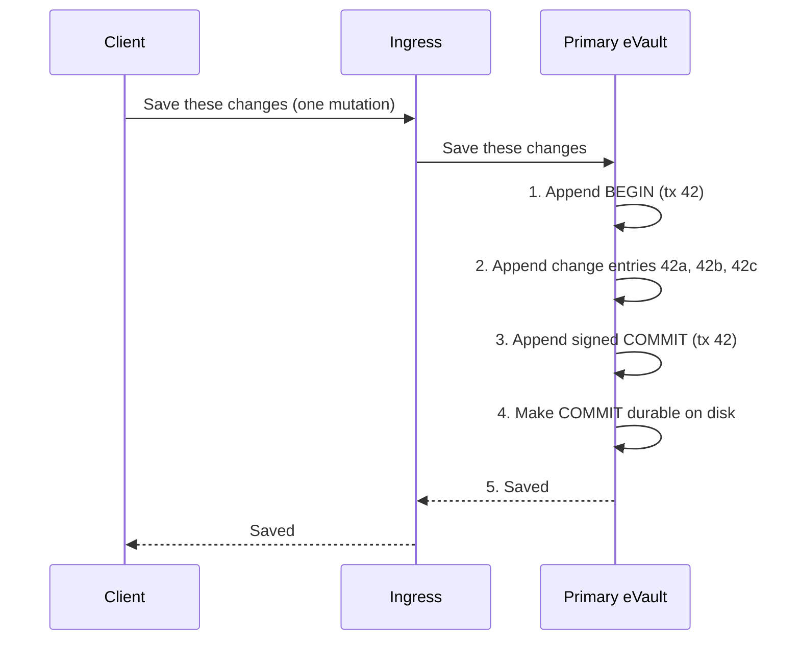
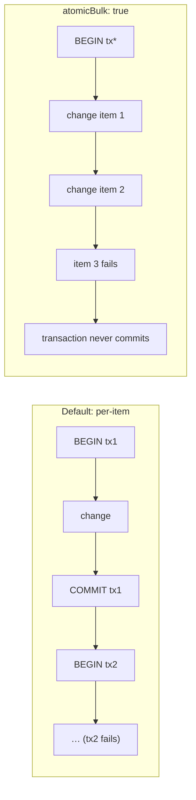

# Transactions in the log

A transaction is the unit of atomicity. Anything that should happen
all-or-nothing has to live inside one. The eVault expresses transactions
directly in its [Write-Ahead Log](/docs/architecture/redundant-evaults/durability)
by bracketing the change entries with a pair of markers.

> **In plain terms**
>
> The log is a numbered list of every change the eVault makes. A transaction
> is just a group of consecutive entries in that list, with a "start" entry
> at the front and a signed "done" entry at the end. Everyone — the local
> store, the replicas, the readers — only treats a group as real once they
> have seen its "done" entry. Until then it doesn't exist.

## The three kinds of entries

Every entry in the log is one of three shapes:

- **`BEGIN`** — opens a transaction. Carries a transaction id, the eName
  whose data is being changed, and a wall-clock timestamp.
- **A change entry** — one create / update / delete / update-envelope-value
  operation, the same shape the prototype already exposes at
  [`/logs`](/docs/Infrastructure/eVault#logs). Carries the operation type,
  the affected envelope id, a content hash, the platform that requested it,
  and the transaction id it belongs to.
- **`COMMIT`** — closes the transaction. Signed by the current primary,
  carries the transaction id, the hash of the last change entry in the
  batch, and the running hash of the whole transaction. This is the only
  entry that "publishes" the change.

The acknowledgement at step 5 only goes out **after** step 4. The
acknowledgement is conceptually attached to the `COMMIT` entry, not to any
single change inside it.

## The commit marker is the lever

Until the `COMMIT` entry is durable, the transaction has no effect anywhere
in the system:

- **The local read path** stops at the last durable commit. A query that
  fires while a transaction is mid-flight will see the state from before
  `BEGIN`, never any partial mid-state.
- **Replication** does not expose change entries that arrive without their
  matching commit. A replica that has streamed `BEGIN` and two of three
  change entries simply waits; if `COMMIT` arrives, it applies the batch as
  one step.
- **Recovery** discards any transaction whose `BEGIN` is durable but whose
  `COMMIT` is not. See [Recovery](recovery).

This is the same lever [PostgreSQL](https://www.postgresql.org/docs/current/wal-intro.html)
uses with its commit records, and the same idea Raft-style replicated logs
encode as the **commit index** — a position in the log past which everything
is final. The eVault uses the same technique with one extra requirement
imposed by the fact that providers are independent: the `COMMIT` entry is
signed by the primary, so a replica cannot forge a commit a primary never
agreed to.

## What counts as a transaction in eVault terms

Mapping the GraphQL surface to transactions:

| GraphQL operation                | Transaction shape                                            |
|----------------------------------|--------------------------------------------------------------|
| `createMetaEnvelope`             | one transaction; one change entry per Envelope, plus the MetaEnvelope itself |
| `updateMetaEnvelope`             | one transaction; one change entry per modified Envelope      |
| `removeMetaEnvelope`             | one transaction; one change entry per Envelope, plus a delete for the MetaEnvelope |
| `updateEnvelopeValue`            | one transaction; one change entry                            |
| `bulkCreateMetaEnvelopes`        | one transaction per input item, all under one outer transaction so a partial-input failure rolls back the whole batch (controlled by a flag — see below) |
| `createBindingDocument`          | one transaction; the document plus the owner signature       |
| `createBindingDocumentSignature` | one transaction; one change entry                            |

The grouping isn't user-visible — a client just calls a GraphQL mutation —
but it pins down what "rolled back together" means for each operation.

For `bulkCreateMetaEnvelopes` the prototype currently allows partial success
(per-item results, see
[the prototype docs](/docs/Infrastructure/eVault#bulkcreatemetaenvelopes)).
Under this design that becomes the default; an `atomicBulk: true` flag
upgrades the call to a single outer transaction so the whole batch
rolls back if any item fails. The two modes correspond to two log shapes:

## Why we replicate the commit marker, not the changes

Replication ships every log entry the primary produces to the replicas (see
[Redundancy](/docs/architecture/redundant-evaults/redundancy)). But a replica
only **applies** a change entry once it has the matching `COMMIT`. Until the
commit arrives, the change entries sit in the replica's log as bytes on disk
and influence nothing.

This has two consequences:

- A replica can be a little behind on commits without being inconsistent. It
  just means the most recent transactions are not yet visible there; the
  state it does expose is a clean snapshot.
- Under the default
  [quorum-synchronous](/docs/architecture/redundant-evaults/redundancy/#quorum-synchronous-the-default)
  setting, the primary waits for at least one replica to durably store the
  **commit** before acknowledging. It does **not** wait for the change
  entries individually; once the commit is on the replica, the entire
  transaction is implicitly on the replica.

## Related systems

The same pattern shows up everywhere atomicity meets a log:

- **PostgreSQL** records a `COMMIT` WAL entry; transactions whose commit
  record never reached disk are discarded on restart.
- **Raft** marks the commit index; everything up to it is final, everything
  after it is provisional.
- **Spanner** uses two-phase commit with timestamps, but the underlying
  idea — that there is one tiny piece of data whose durability decides the
  fate of a whole batch — is the same.

The eVault's version differs only in that the deciding piece of data
(the `COMMIT` entry) is also **signed**, so independent providers can verify
each other without trusting each other.
