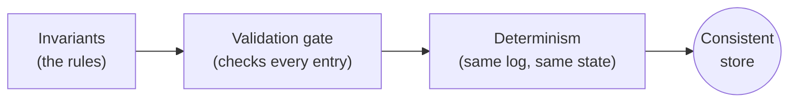

# Consistency

Consistency is the **C** in ACID. It is the rule that the eVault only ever
moves from one valid state to another. A change that would break a rule is
refused; a change that is accepted is one the rules already permit. Where
[atomicity](/docs/architecture/atomicity) is about a single change being
indivisible, consistency is about the **rules** the change has to clear —
and about every replica, on every machine, agreeing on which rules they
are.

> **In plain terms**
>
> The eVault has a short, fixed list of rules every piece of data has to
> satisfy: the right shape, the right signatures, sensible permissions, a
> clean log chain. Every change is checked against those rules before it is
> allowed in. Because all three replicas check the same rules in the same
> order, they never disagree about what is in the store.

## Why eVaults need consistency

A single-user eVault holding loosely-typed JSON might get away without an
invariant list — the user can fix their own bad data. The W3DS eVault
cannot:

- It is read by **other people's platforms** through GraphQL queries that
  expect a specific ontology shape. A MetaEnvelope whose payload silently
  drifts from its declared schema breaks every reader.
- It enforces **access control** through ACLs. An ACL that is a malformed
  string, or that names a W3ID that does not exist, doesn't fail loudly —
  it just denies access to the wrong people.
- It is **replicated** across three independent providers (see
  [Redundancy](/docs/architecture/redundant-evaults/redundancy)). Two
  replicas drifting silently from the third would create a quiet split in
  what users see depending on which replica answers them.
- It feeds the **Awareness Protocol**, the
  [Registry](/docs/Infrastructure/Registry), and downstream platforms with
  events derived from its state. Garbage in produces garbage out, with no
  recovery path.

Consistency is what lets all of that be built on top of the eVault: every
participant downstream can rely on the rules holding, because no log entry
that breaks the rules can ever be applied.

## The shape of consistency

This section covers three layers, each on its own page:

- **[Invariants](invariants)** — the full list of rules the eVault enforces.
  Most of them are already implicit in the prototype; stating them together
  makes the contract explicit.
- **[Validation](validation)** — the apply-time gate that every log entry
  has to clear before it touches the stored state. Same gate on the primary
  and every replica, same checks, same refuse-and-alarm behaviour.
- **[Determinism](determinism)** — the property that follows from running
  the same gate over the same log on every replica: all replicas converge
  to the same state, without any separate agreement protocol between them.

## What sits behind consistency

Consistency rides on the same
[Write-Ahead Log](/docs/architecture/redundant-evaults/durability) as
atomicity and durability. The log is the only place state changes; the
validation gate is the only thing that lets a log entry through. Together
they reduce "is the store consistent?" to "does every entry pass the
checks?", which is a property of code, not of any particular machine.

## Where consistency stops

- **Consistency does not mean instant cross-eVault agreement.** Two
  different eVaults can hold related data (an ACL grant on one, a binding
  document on another). Whatever cross-eVault discipline they share is
  covered in [Cross-eVault atomicity](/docs/architecture/atomicity/cross-evault);
  inside any single eVault, consistency still holds.
- **Consistency does not mean clients always see the latest write.**
  Replicas can be a moment behind. Whatever ordering guarantees the read
  path offers — for example "read your own writes" — are covered in
  [Redundancy](/docs/architecture/redundant-evaults/redundancy/#reads-and-replication-lag).
- **Consistency does not police user intent.** The rules check shape,
  signatures, and permissions; they do not check whether the change is
  what the user meant.

## Related sections

- [Atomicity](/docs/architecture/atomicity) — the **A** in ACID, the
  parallel property to this one.
- [Durability](/docs/architecture/redundant-evaults/durability) — the log
  the validation gate runs over.
- [Redundancy](/docs/architecture/redundant-evaults/redundancy) — where the
  validation gate is reused as part of replica tamper-evidence.
