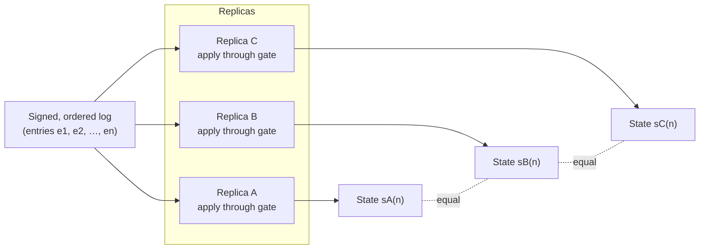

# Determinism across replicas

Three independent eVaults, three independent providers, three independent
machines, three independent processes — and yet they all have to converge on
the same state. The way they do it is **state-machine replication**: every
replica is a deterministic state machine whose only input is the log, and
the [validation gate](validation) is the only transition function it has.

> **In plain terms**
>
> If three friends each follow the same recipe in the same order starting
> from the same ingredients, they end up with the same dish. The eVault's
> log is the recipe, the replicas are the friends, and the validation gate
> makes sure nobody can sneak in an ingredient the recipe never asked for.

## Same log, same order, same state

The argument is mechanical:

1. The log is a **total order** of entries. Sequence numbers are strictly
   increasing, gap-free, and signed.
2. Every replica receives the log entries through replication and applies
   them through **the same gate** (see [Validation](validation)).
3. The gate is **deterministic** — same input, same output. No random
   numbers, no wall-clock dependence, no environment-dependent branches.
4. Therefore: if two replicas have the same starting state and process the
   same log prefix, they end up at the same state.

That is the entire proof of consistency between replicas. There is no
separate gossip protocol, no Paxos round, no anti-entropy sweep. The log
**is** the agreement, and the gate **is** the apply step.

After applying log prefix `e1..en`, every replica's state is the same
function of `n`. That function is the validation gate composed with the
starting state.

## Why this matters

State-machine replication's payoff is that you can stop reasoning about
distributed consistency and start reasoning about a single state machine.
Concretely:

- **No anti-entropy.** The eVault never runs a "compare every key across
  replicas" sweep. If a replica's log is up to date, its state is up to
  date.
- **No quorum reads.** A read served by a single replica is correct as
  long as that replica's log is up to date.
- **No conflict resolution.** Two writes never conflict, because writes go
  through one primary that gives them sequence numbers; the order is
  already decided by the time a replica sees them.

This is the same property that lets Raft, Paxos, [Spanner](https://research.google/pubs/pub39966/),
CockroachDB, and a generation of replicated systems give strong consistency
without paying for it on every read. The eVault is in the same family;
its specialisation is signed entries and a gate that does invariant
checks, so it can run across providers that do not trust each other.

## What can drift, and what cannot

The reasoning above assumes "the same log prefix". Replicas can be behind:
replication is not instantaneous. What that means in practice:

- **State at a given log position is identical across replicas.** Once a
  replica has applied entry `en`, its state for that prefix matches every
  other replica's state for the same prefix.
- **The log position itself varies between replicas in flight.** Replica
  B may have applied up to `e1000` while replica C has only applied up to
  `e995`.
- **A read on a lagging replica returns a slightly older but still
  consistent state.** It is never inconsistent — it is just earlier.

The ingress routes reads to a replica that has caught up to the writes
the client cares about (see
[Redundancy](/docs/architecture/redundant-evaults/redundancy/#reads-and-replication-lag)).
A read that has to be "as of the latest committed write" goes to the
primary; a read that can tolerate a few seconds of lag goes to whichever
replica is free. Either way, what comes back is a snapshot of a real
prefix of the log, never an interleaving.

## Why the gate has to be pure

The gate's determinism is load-bearing. If any check inside it depended on
the wall clock, the current network state, or the identity of the running
machine, two replicas would diverge the moment they saw the same entry at
different times. To prevent that:

- **No wall-clock reads inside the gate.** Timestamps inside log entries
  are the primary's wall clock at the moment of writing; the gate trusts
  the entry's timestamp, it does not consult its own.
- **No external lookups inside the gate.** Schema resolution against the
  Ontology service happens at write time on the primary; the resolved
  schema is **embedded** in the entry (or its hash) so replicas do not
  re-resolve and possibly get a different answer.
- **No environment-dependent branches.** The gate's code path is the same
  on every node — same library version, same configuration. Code drift
  between replicas is treated as a deployment bug, not as an acceptable
  state.

In practice this means the gate runs over data the entry itself carries,
with no side inputs. That keeps determinism a property of the entry, not
of the world around it.

## Comparing to other systems

The trade-offs of state-machine replication are well-known:

- **[Raft](https://raft.github.io/)** uses leader election plus a
  replicated log; same shape, with a different leader-election protocol.
- **[Paxos](https://lamport.azurewebsites.net/pubs/paxos-simple.pdf)** is
  more general but harder to reason about; in practice Raft's structure
  is what most deployed systems look like.
- **[Spanner](https://research.google/pubs/pub39966/)** layers
  externally-consistent timestamps on top so reads across multiple log
  groups stay in step.
- **[CockroachDB](https://www.cockroachlabs.com/docs/stable/architecture/replication-layer)**
  is Raft per range, with cross-range transactions stitched on top.
- **PostgreSQL streaming replication** is a single-leader log shipped to
  followers; mechanically the closest comparison to the eVault.

The eVault's chief difference from the database family is that its log
entries are **signed by the primary**, so a follower that is not the same
organisation as the leader can still verify each entry independently.
Determinism plus signed entries is what makes "three companies hold the
same data" something other than "three companies hope they hold the same
data".

## The payoff in one sentence

The eVault never has to ask its replicas what they think the state is —
it asks them whether their log is up to date, and the state follows.
