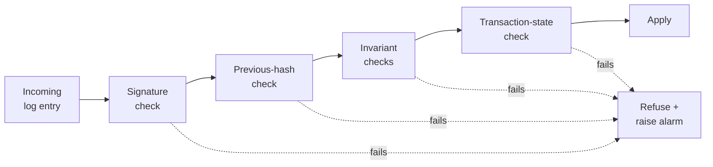
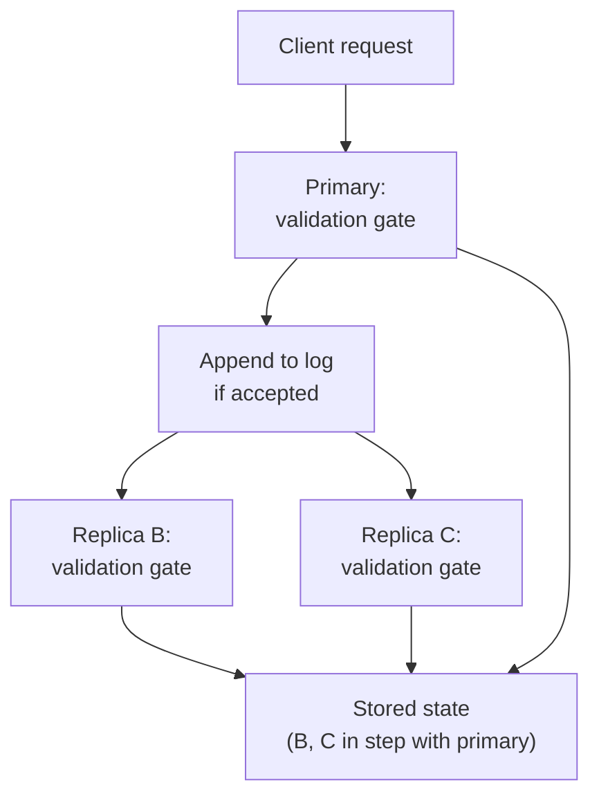

# The validation gate

The [invariants](invariants) are a list of rules. The **validation gate** is
the code path that enforces them on every log entry, on every machine, the
same way. It is the only door an entry can take to become part of the
stored state.

> **In plain terms**
>
> The eVault has one checkpoint that every change has to pass through
> before it counts. The checkpoint asks the same questions every time, in
> the same order: is the signature real, does the chain still match, do
> the rules hold? Only changes that pass all three questions are written
> to the store. Anything that fails is refused on the spot and reported.

## The gate

Every log entry travels through the same gate before its effects become
visible:

Four ordered checks:

1. **Signature.** The entry must be signed by the current primary, and the
   primary's key has to chain back to a valid key-binding certificate (see
   [Durability](/docs/architecture/redundant-evaults/durability/#making-the-log-trustworthy-across-independent-providers)).
2. **Previous-hash.** The entry's `prevHash` field must match the hash of
   the entry the receiving node has already accepted at the previous
   sequence number.
3. **Invariants.** The entry's payload is run against every relevant
   invariant from the [invariants list](invariants). Schema entries
   trigger schema checks, ACL entries trigger ACL checks, and so on.
4. **Transaction state.** Change entries must reference a `BEGIN` that is
   currently open at the receiving node; `COMMIT` entries must close an
   open transaction whose change-entries form the expected hash.

The first two checks are the tamper-evidence already in
[Redundancy](/docs/architecture/redundant-evaults/redundancy/#replicas-check-every-entry-before-applying-it).
The third is the consistency contribution. The fourth ties the gate to
[atomicity](/docs/architecture/atomicity/transactions). Putting them on the
same code path is what makes them affordable: each check is a constant-time
inspection of a small chunk of data, and the eVault was already going to
walk the entry's fields anyway.

## The same gate runs on the primary and on every replica

The single most important property of the gate is that it is **the same on
every machine**. The primary runs it when a write request first arrives;
every replica runs it again when the entry streams in over replication.
This redundancy is not wasteful: it is how the design tolerates
independent providers.

If the primary's gate rejects an entry, the entry never enters the log. If
a replica's gate rejects an entry that did make it past the primary, the
replica refuses to apply it. Both refusals raise the same alarm — a
discrepancy between primary and replica is treated as a serious incident,
not as something to paper over.

## What happens when a check fails

A refused entry is **never** silently dropped. The eVault treats a
validation failure as one of four named events, depending on which check
fired:

| Check fired | Named event       | Likely cause                                                                                  | Reaction                                                              |
|-------------|-------------------|-----------------------------------------------------------------------------------------------|-----------------------------------------------------------------------|
| Signature   | `tamper-evidence` | Wrong signing key, forged primary, or corrupted entry in transit.                              | Refuse, stop applying further entries from this primary, raise alarm. |
| Chain       | `chain-break`     | Reordered or missing entry, replay attack, or a divergent tail after failover.                 | Refuse, request a re-stream from the last good entry, raise alarm.    |
| Invariant   | `constraint-violation` | Bug in client code, malicious platform, schema drift, ACL targeting a non-existent eName. | Refuse, return the violation to the originating client, do not alarm. |
| Transaction | `transaction-state` | Re-ordering, late delivery, or a duplicate `COMMIT`.                                          | Refuse, hold for re-delivery, raise alarm if it persists.             |

The distinction matters operationally: `constraint-violation` is the only
one the eVault should expect to see in normal operation (clients send bad
data; they get told no). The other three are alarms — they say a provider,
the network, or the code itself is misbehaving.

## Cost

Every log entry pays the gate's cost on every node that touches it.
Concretely, the costs are small:

- **Signature check** — one elliptic-curve verification per entry. A modern
  server does tens of thousands of these per second per core.
- **Hash check** — one 32-byte comparison.
- **Invariant checks** — pure functions of the entry's payload, no I/O.
  Schema validation against a cached ontology schema is a single tree
  walk; ACL parsing is a fixed-size loop.
- **Transaction-state check** — one lookup in a small in-memory map of
  open transactions.

The total is well under a millisecond per entry on commodity hardware.
The gate is not the bottleneck and was deliberately designed not to be:
its job is to be cheap enough that you can afford to run it on every
node, every time.

## Why the gate is the only entry point

Nothing else writes to the store. Reads serve from the store but do not
write. Webhook delivery does not write. Replication itself does not write
— it appends to the log, and the apply step (which runs the gate) is the
only thing that reaches the store. As a result, every byte in the store
arrived there through a gate that approved it, and "the store is
consistent" reduces to "the gate is correct" — a property of code, not of
operations.

The next page, [Determinism](determinism), shows what falls out when
every replica runs the same gate over the same log.
