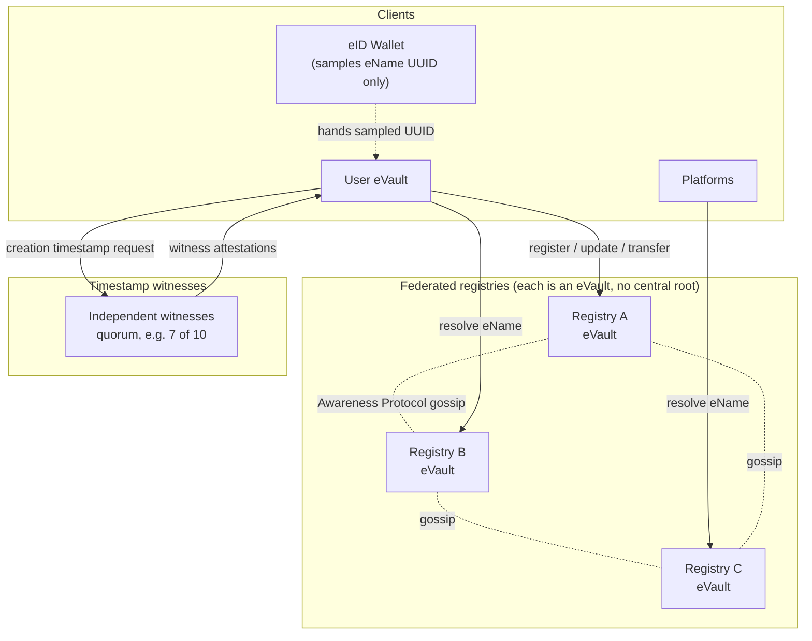

# Decentralised Registry

This section proposes a decentralised replacement for the single centralised
[Registry](/docs/Infrastructure/Registry). It is shaped by two requirement
documents, and is meant to be read against them:

- [W3ID and eName Requirements](https://github.com/w3ds-docs/w3ds-docs/wiki/W3ID-eName-Requirements)
- [W3DS Registry Requirements v2](https://github.com/w3ds-docs/w3ds-docs/wiki/W3DS-Registry-Requirements-v2)

> **In plain terms**
>
> The Registry's job is to answer one question about any user: where is their
> [eVault](/docs/Infrastructure/eVault) right now. A client supplies an eName
> and gets back the current address. Today one organisation runs this service
> on its own infrastructure. If that organisation's servers fail, if it alters
> an entry, or if it refuses to answer a lookup, every user and platform is
> affected at once. Decentralised means the same service is run by many
> independent organisations at the same time, so no single one of them can
> break it, alter an entry, or block a lookup on its own.

## Background

The current Registry is one service that every client trusts. Requirement
`NFR1` defines its core role plainly: it is a resolver that maps a global
W3ID or eName to the current eVault location. That single job is the focus of
this design.

Two things that earlier versions of the Registry did are explicitly **not**
registry functions any more:

> **Note on entropy and key binding**
>
> The previous `GET /entropy` endpoint is out of scope. Provisioning flows
> that needed entropy generate it locally in the
> [eID Wallet](/docs/Infrastructure/eID-Wallet) instead.
>
> Key binding, the act of vouching that a public key belongs to an identity,
> is also out of registry scope. Requirements `NFR3` and `NFR13` are explicit:
> the registry is not the source of truth for user keys or identity, and the
> [eVault](/docs/Infrastructure/eVault) is the source of truth for its own
> certificates. Key binding certificates therefore live in the eVault, with
> attestation moving to the future Remote Notary. The registry only resolves
> locations.

A single Registry is a [single point of failure](https://en.wikipedia.org/wiki/Single_point_of_failure),
a single point of trust, and a single point of censorship. One operator can
withhold a resolution, alter an entry, or disappear and break every eName at
once. That contradicts the decentralised goals of W3DS.

## Design goals

The requirement documents pin down the model. The design must satisfy all of
the following.

- **Persistent resolution.** A W3ID is a long-lived identifier, designed to
  stay stable for the lifetime of the entity and across key rotation and
  eVault migration (W3ID Sections 4 and 7).
- **Federated peers, no central root.** Registries operate as peers, with no
  mandatory central root (`NFR10`). A new or low-reputation registry cannot
  make an established record change just by claiming the change is correct.
  Peers only accept an update when the record's own signed chain (transfer
  signatures, witnessed timestamps, version monotonicity) proves it (`NFR11`).
- **Eventual consistency.** Registries must assume
  [eventual consistency](https://en.wikipedia.org/wiki/Eventual_consistency)
  and tolerate temporarily incomplete knowledge of their peers, and of the
  world in general (`NFR4`, `NFR5`).
- **Conflicts detected, never hidden.** Duplicate or contradictory records are
  expected. A registry must detect them and must not silently overwrite or
  silently resolve them (`FR9`, `FR21`, `FR23`). See
  [Gossip protocol, Example D](gossip-protocol/#example-d-a-conflict-and-how-it-is-resolved)
  for the resolution procedure.
- **Auditable history.** Two layers of audit coexist. The *content* audit, what
  the resolution record actually says, is owned by the user's
  [eVault](/docs/Infrastructure/eVault): a registry can link the current record
  back to the eVault MetaEnvelope it was sourced from. The *operational* audit,
  how each registry came to know what it knows (which peer gossiped it, which
  witness signed it, which conflict was raised), is kept by each registry as
  an append-only tamper-evident log on its own `/logs` (`FR37`, `FR38`).

## The headline idea

Each registry is itself an [eVault](/docs/Infrastructure/eVault). Registries
write gossip messages into their own eVaults; the existing
[Awareness Protocol](/docs/W3DS%20Protocol/Awareness-Protocol) then delivers a
webhook notification of each write to every subscribed peer registry. Almost
no new machinery is introduced: storage, audit, and peer delivery are all
primitives W3DS already has.

> **In plain terms**
>
> An eVault is a data store that already knows how to keep signed records,
> list every change it ever made, and notify subscribers when something
> changes. A registry is one of these eVaults with a particular job: instead
> of storing one user's posts and contacts, it stores the resolution records
> for many eNames. Other registries subscribe to its notifications, so a
> change made on one registry shows up on the others within seconds. There is
> no master copy, no special transport, no new protocol.

The one wrinkle is that a registry's own eVault **has no eName**. The reason
is circular: the registry is what dereferences eNames, so the registry's own
eVault cannot be looked up by an eName without depending on itself. It still
has an eVault W3ID for internal identification (W3ID Section 6), and clients
find a registry by a published seed URL rather than by resolution.

## The federated model

Continue to [Architecture](architecture).

## Promoting a local W3ID into an eName

The [Identifiers](/docs/architecture/identifiers/anatomy) section draws the
distinction the rest of this proposal relies on: a **W3ID** is the bare UUID
identifier and may be local to a single eVault, while an **eName** is a W3ID
that has been registered for global resolution. Local W3IDs are not
registered, so they cannot be resolved by anyone outside the owning eVault.
Sometimes a local identifier needs to become globally resolvable, for example
when a private object inside an eVault (a document, a digital twin, a group)
needs an address the wider system can reach.

> **In plain terms**
>
> Something that started life as a private label inside one eVault becomes a
> public address. The label keeps its same characters; what changes is that
> a registry now answers when someone asks for it, and the answer points
> straight at the specific resource inside the eVault, not at the eVault as
> a whole.

Promotion is a normal registration with two extra details:

- The owning eVault writes a new `ENameRecord` whose
  `creationRecord.promotedFrom` carries the original local W3ID. That field
  is the audit trail tying the new eName back to what it used to be.
- The record's `uri` field points at the resource's path inside the eVault
  (for example `https://evault.example.com/users/alice/objects/twin-42`),
  not at the eVault root. Resolution therefore returns the URI of the
  resource itself, satisfying clients that want to reach the specific
  object the eName now stands for.

Everything else (witnessed timestamps, signed creation record, federation
gossip) is identical to a first-time eName registration. The original local
W3ID continues to exist inside the eVault for backwards compatibility; the
new eName is the canonical globally-resolvable identifier from the moment
the record lands.

## References

- [W3ID and eName Requirements](https://github.com/w3ds-docs/w3ds-docs/wiki/W3ID-eName-Requirements)
- [W3DS Registry Requirements v2](https://github.com/w3ds-docs/w3ds-docs/wiki/W3DS-Registry-Requirements-v2)
- [Registry](/docs/Infrastructure/Registry) for the current centralised design.
- [W3ID](/docs/W3DS%20Basics/W3ID) for identifier format, the ID log, key
  rotation, and migration.
- [eVault](/docs/Infrastructure/eVault) for the storage and webhook primitives
  reused here.
- [Awareness Protocol](/docs/W3DS%20Protocol/Awareness-Protocol) for the
  webhook delivery mechanism used for gossip.
- [Ontology](/docs/Infrastructure/Ontology) for how the gossip message schemas
  are published.
