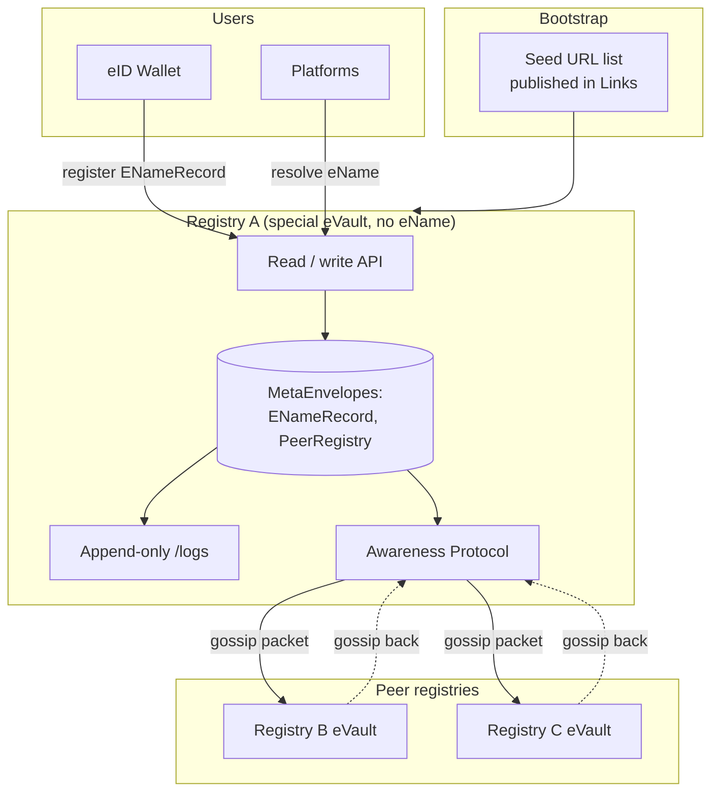

# Architecture

This page describes the structural design: what a registry is built from, the
shape of an eName record, how audit history is kept, and how registries find
each other. For the problem statement and design goals see the
[Overview](../). For how registries actually exchange records, continue to
[Gossip protocol](../gossip-protocol).

## A registry is a special eVault

A registry is the standard [eVault](/docs/Infrastructure/eVault) you already
know from the prototype docs, with a specific role and three small
differences. Everything else carries over: MetaEnvelopes, Envelopes, the
read/write API, ACLs, the append-only `/logs` endpoint, and the
[Awareness Protocol](/docs/W3DS%20Protocol/Awareness-Protocol) for change
notifications.

> **In plain terms**
>
> An eVault is a data store that knows how to keep signed records, list every
> change it ever made, and notify subscribers when something changes. A
> registry is one of these eVaults, configured to store one specific kind of
> record (eName resolution records) and to talk to other registries instead of
> to user-facing platforms. By starting from a primitive that already exists,
> the design avoids inventing a new storage layer, a new audit log, and a new
> peer transport.

The three differences from a user eVault:

- **No eName.** Every eVault has an internal eVault W3ID (W3ID Section 6).
  User eVaults are also registered for global eName resolution; a registry
  eVault is not, because dereferencing eNames is the registry's own job and
  doing so would be circular. The registry is found by URL from a published
  seed list instead.
- **Bootstrap by seed list, not by resolution.** A new registry contacts one
  or more **seed registry URLs** published in
  [Links](/docs/W3DS%20Basics/Links). From those it learns the rest of the
  federation through ordinary peer exchange (see
  [Gossip protocol](../gossip-protocol)).
- **Public read, ACL-gated writes.** eName resolution records use a read ACL
  of `["*"]`, so any client can resolve any eName from any registry. The
  MetaEnvelope's *write* ACL contains the controller's eName, so the
  controller can self-service updates through the same auth flow user eVaults
  already use. The registry independently re-verifies the record's signed
  update chain (`controlKey` rotation, version monotonicity, immutable
  fields) before persisting the write.

## eName records as MetaEnvelopes

An eName record is a MetaEnvelope stored in the registry's eVault under a new
**`ENameRecord`** ontology schema. The schema is published the same way every
other W3DS schema is, through the [Ontology](/docs/Infrastructure/Ontology)
service, and gets a `schemaId` W3ID. Every record the registry holds is an
**eName** by definition. Local W3IDs (no `@` prefix) live only inside the
owning eVault and are never resolved by the registry; the
[Identifiers anatomy](/docs/architecture/identifiers/anatomy) page is the
canonical reference for the terminology. Promotion of a local W3ID into an
eName is described in the
[Overview](_index/#promoting-a-local-w3id-into-an-ename).

```json
{
  "$schema": "http://json-schema.org/draft-07/schema#",
  "schemaId": "a1b2c3d4-1111-2222-3333-444455556666",
  "title": "ENameRecord",
  "type": "object",
  "properties": {
    "ename":            { "type": "string", "description": "Registered eName (global W3ID)" },
    "controller":       { "type": "string", "description": "Controller eName" },
    "evault":           { "type": "string", "description": "Current eVault W3ID" },
    "uri":              { "type": "string", "format": "uri" },
    "version":          { "type": "integer", "minimum": 1 },
    "creationRecord":   { "type": "object" },
    "transferChain":    { "type": "array",  "items": { "type": "object" } },
    "controlKey":       { "type": "string" },
    "conflictStatus":   { "type": "string", "enum": ["none", "conflict_pending_review", "resolved"] },
    "updatedAt":        { "type": "integer" },
    "proof":            { "type": "object" }
  },
  "required": ["ename", "controller", "evault", "uri", "version", "creationRecord", "controlKey", "updatedAt", "proof"],
  "additionalProperties": false
}
```

A concrete record:

```json
{
  "ename": "@e4d909c2-5d2f-4a7d-9473-b34b6c0f1a5a",
  "controller": "@e4d909c2-5d2f-4a7d-9473-b34b6c0f1a5a",
  "evault": "@b1c2d3e4-7f80-4a11-9c22-d3e4f5061728",
  "uri": "https://evault.example.com/users/user-a",
  "version": 3,
  "creationRecord": {
    "creationTimestamp": 1737730800,
    "genesisKey": "zGenesisPublicKey...",
    "promotedFrom": null,
    "timestampProof": {
      "policy": "7-of-10",
      "witnesses": [
        { "witness": "witness-01", "attestedAt": 1737730805, "signature": "z..." },
        { "witness": "witness-04", "attestedAt": 1737730802, "signature": "z..." }
      ]
    },
    "proof": { "type": "ecdsa-2019", "signature": "zGenesisSelfSignature..." }
  },
  "transferChain": [],
  "controlKey": "zCurrentControlKey...",
  "conflictStatus": "none",
  "updatedAt": 1737900000,
  "proof": {
    "type": "ecdsa-2019",
    "verificationMethod": "@e4d909c2-...#control-key-2",
    "signature": "zSignatureByPreviousControlKey..."
  }
}
```

By convention the `ENameRecord` MetaEnvelope's ID is the eName itself, so
resolution and storage share a single primary key.

What the fields mean:

- `ename`, `controller`, `evault`, `uri`: the resolution result. The
  `controller` eName identifies the person, group, or device, and is kept
  distinct from the `evault` W3ID, which identifies one eVault instance (W3ID
  Section 6). The `uri` is the address resolution returns and may point at
  the eVault root or, for a promoted local W3ID, at the specific resource
  inside the eVault.
- `creationRecord`: the genesis of the eName. Written once and **never
  overwritten** (`FR30`). Carries the `creationTimestamp`, a `genesisKey`, an
  optional `promotedFrom` field (set to the original local W3ID when this
  eName was minted by promotion, otherwise `null`), and a `timestampProof`
  from a quorum of independent witnesses (W3ID Section 9, `FR16` to `FR19`).
- `transferChain`: an ordered list of signed transfer records, empty until the
  eName first moves eVault (W3ID Section 10, `FR26` to `FR31`).
- `controlKey`: the key currently allowed to authorise updates to this record.
  Rotating it is itself a signed update. This is internal registry
  authorisation only, separate from user key binding.
- `conflictStatus`: `none`, `conflict_pending_review`, or `resolved`
  (`FR8`, `FR25`).
- `version`, `updatedAt`, `proof`: the current state and the owner signature
  over it. An update is only accepted if its `version` is exactly one greater
  than the current one and its `proof` verifies against the previous version's
  `controlKey`.

Updates and key rotation are ordinary version-bumped MetaEnvelope updates.
The eName is never changed by either (W3ID Section 5). Rotation is itself a
signed update: the new `controlKey` is set by an update whose `proof` is
signed by the *previous* `controlKey`, so the rotation chain is verifiable
end-to-end.

### Field-level invariants on writes

Some fields are locked or monotonic regardless of who signs the update; the
registry enforces these at write time, not via the ACL. An update violating
any of them is rejected even when its signature verifies.

- `ename` is immutable. An update that attempts to change it is rejected.
- `creationRecord` (and every field inside it, including `creationTimestamp`,
  `genesisKey`, `promotedFrom`, and `timestampProof`) is immutable.
- `version` must equal current `version` + 1. Older or skipped versions are
  rejected.
- `proof` must verify against the previous version's `controlKey`. A
  rotation update binds the new key by being signed under the old one.
- `controller` may change only through a `transferChain` entry whose
  signatures and authorisation evidence verify against the current
  `controlKey` (`FR26` to `FR31`).

The write ACL governs *who is allowed to attempt* a write; these invariants
govern *what the write is allowed to contain*. Both checks have to pass.

## Audit history through the eVault `/logs`

The eVault already exposes a paginated, append-only log of every envelope
operation (create, update, delete) with `eName`, `metaEnvelopeId`,
`envelopeHash`, `operation`, `platform`, `timestamp`, and `ontology` per entry.
See the [eVault `/logs` documentation](/docs/Infrastructure/eVault#logs).

Public exposure of `/logs` is specific to the registry eVault, whose contents
are public by design. User eVaults are not assumed to expose their `/logs` to
the world; the requirement here applies only to registries, where every
record is already public.

Mapping that log directly satisfies the registry audit requirements:

- Every eName record change is a MetaEnvelope write, so it is logged.
- Conflict detections, conflict resolutions, and reputation changes are also
  written as MetaEnvelopes (under separate ontologies described in
  [Gossip protocol](../gossip-protocol)), so they are logged too.
- The log entry already carries everything `FR38` asks for: type, timestamp,
  previous and new value (via `envelopeHash`), source (`platform`), evidence
  reference, and is served by an eVault whose responses are signed by the
  registry. No new audit machinery is needed.

## Peer list as a MetaEnvelope

The set of peer registries a given registry knows about is stored in its own
eVault as MetaEnvelopes under a **`PeerRegistry`** ontology:

```json
{
  "peerEVault": "@registry-b-evault-w3id",
  "url": "https://registry-b.w3ds.example",
  "reputation": 0.92,
  "lastSeen": 1737900000
}
```

Peer entries are themselves gossiped (see
[Gossip protocol](../gossip-protocol)), so the federation discovers itself.
Reputation drives `FR33` and `FR34`: a low score downgrades records sourced
from that peer.

## Topology



## Example A: registering an eName (push)

The eID Wallet samples the eName UUID at creation time and hands it to the
owning eVault (see the
[Identifiers lifecycle Step 2](/docs/architecture/identifiers/lifecycle)).
From there the eVault collects witness timestamps, builds the v2 record,
and submits it to a registry as a new MetaEnvelope under the `ENameRecord`
ontology, with read ACL `["*"]` and write ACL containing the controller
eName. The registry:

1. Validates the record against the `ENameRecord` schema.
2. Checks the witness quorum on `creationRecord.timestampProof` and the
   genesis self-signature.
3. Runs a best-effort duplicate check against its own records (`FR11`,
   `FR12`).
4. Stores the MetaEnvelope.
5. Lets the [Awareness Protocol](/docs/W3DS%20Protocol/Awareness-Protocol)
   fire a notification to every subscribed peer registry (the peer-side flow
   is the subject of the next page).
6. The store operation also lands in the eVault `/logs`, giving the audit
   history for free.
7. Subscribes itself to the source eVault's Awareness Protocol, so any
   subsequent change to the eName record reaches the registry by pull
   without another direct write (see Example A').

The exact request shape is whatever the production eVault read/write API
turns out to be; what matters here is the conceptual call: "create an
`ENameRecord` MetaEnvelope with this payload."

## Example A': following changes by pull

After the initial push, the source eVault becomes the source of truth for
the record's content. The owning eVault keeps its own copy of the eName
record (URI, controlKey, transfer chain) and publishes updates to it the
same way it publishes any other MetaEnvelope change. Because the registry
subscribed to that eVault in step 7 of Example A, every subsequent change
flows by pull:

1. The user's eVault writes the updated record (URI change, key rotation,
   transfer) into its own MetaEnvelope store.
2. The eVault's [Awareness Protocol](/docs/W3DS%20Protocol/Awareness-Protocol)
   fires a webhook to every subscribed registry.
3. Each registry validates the signed update chain (`controlKey` rotation,
   version monotonicity, immutable fields, transfer signatures).
4. The registry applies the change to its own `ENameRecord` MetaEnvelope,
   which lands in its `/logs` for free.
5. The registry's own Awareness Protocol then gossips the change onward to
   peer registries (the next page).

Initial creation stays a push because the registry has no eVault to
subscribe to yet at that point. Everything afterwards is pull.

## Example B: resolving an eName

Resolution is a lookup against the registry's store: find the
`ENameRecord` MetaEnvelope whose `ename` matches the requested W3ID, and
return its current state. A registry that wants a backward-compatible API can
expose a thin `GET /resolve?w3id=...` shim that wraps the lookup, so existing
clients of the current Registry need no change.

The response carries the eName record, including its `conflictStatus`. If the
status is anything other than `none`, the conflict metadata travels with it
(`FR8`, `FR10`).

Continue to [Gossip protocol](../gossip-protocol).
