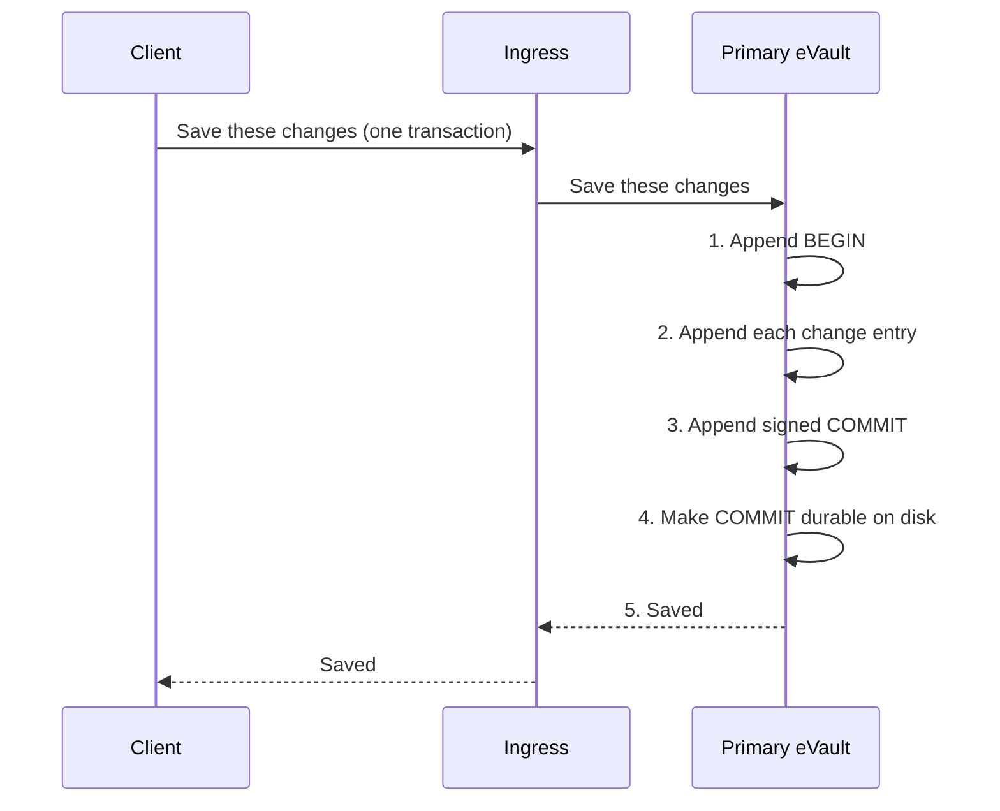
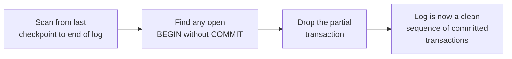

# Atomicity: all or nothing

Atomicity means a change is either fully recorded or not recorded at all. There
is no third option where a write is half-done. This is the **A** in ACID, and
it sits directly on top of the [Write-Ahead Log](durability).

> **In plain terms**
>
> When you save something that touches several pieces of data at once, the
> eVault treats the whole save as one event. Either every piece lands together
> or none of them do, even if the power goes out halfway through. You never
> see a half-saved state, and nothing you were told was saved can later turn
> out to have only partly happened.

## A transaction is a batch of log entries

A single client request can produce more than one change. Updating a
MetaEnvelope, for example, can touch several Envelopes underneath it. All of
those changes belong together. The eVault groups them into one **transaction**
by bracketing them in the log:

- A `BEGIN` marker opens the transaction.
- One or more change entries follow, in the order the primary made them.
- A signed `COMMIT` marker closes the transaction. The commit marker carries
  the hash of the last entry in the batch, so it nails the batch to a specific
  shape.

This is the same trick [PostgreSQL](https://www.postgresql.org/docs/current/wal-intro.html)
uses with its commit records, and the same idea Raft and similar log-replication
protocols use to mark the **commit index**: a position in the log past which
everything is final.

The acknowledgement at step 5 only goes out **after** step 4. Until the
`COMMIT` entry is durable, the transaction has no effect: readers ignore
anything past the last durable commit, and a replica will not expose changes
from a transaction whose commit marker has not yet arrived. This is the lever
that makes a multi-entry change behave as one atomic unit.

## Crash recovery rolls back partial transactions

When the primary restarts after a crash, it does the same checkpoint-and-replay
walk described in [durability](durability/#recovery-after-a-crash), with one
extra rule: any transaction whose `BEGIN` is present but whose `COMMIT` is
**not** is thrown away. Half-written transactions are not "almost saved", they
are not saved at all.

Because the acknowledgement only ever followed a durable `COMMIT`, nothing the
client was told was saved can be in the discarded tail. The rule is symmetric:
saved means committed, committed means durable, durable means a `COMMIT` entry
made it to disk. Anything that does not clear all three is rolled back on
restart.

The same rule applies during a [failover](failover) when an old primary
[rejoins](failover/#the-old-primary-rejoins) the replica set: any partial
transaction on its divergent tail is dropped wholesale during the rewind. It
does not matter that some change entries from that transaction survived — the
batch is incomplete, so the whole batch is gone.
