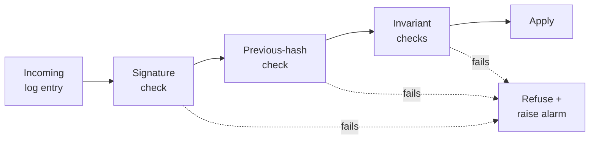

# Consistency: invariants hold

Consistency means the eVault only ever moves from one valid state to another.
A change that would break a rule is refused; a change that is accepted is one
the rules already permit. This is the **C** in ACID.

> **In plain terms**
>
> The eVault has a short list of rules every piece of data has to satisfy:
> the right shape, the right signatures, sensible permissions. Every change is
> checked against those rules before it is allowed in. Because all three
> replicas check the same rules in the same order, they never disagree about
> what is in the store.

## The invariants the eVault enforces

The eVault has a small, fixed set of invariants. Most of them are not new in
this proposal — they are already implicit in the prototype — but stating them
together makes it clear what "valid state" means.

- **The log hash-chain is unbroken.** Every log entry carries the hash of the
  previous one. See
  [durability](durability/#making-the-log-trustworthy-across-independent-providers).
- **Every log entry is signed by the current primary.** A replica cannot
  fabricate an entry the primary never produced.
- **Every transaction is bracketed by `BEGIN` and a signed `COMMIT`.** No
  dangling `BEGIN`, no orphaned changes — see [atomicity](atomicity).
- **A MetaEnvelope payload conforms to its declared ontology.** The ontology
  W3ID on a MetaEnvelope resolves to a schema (via the
  [Ontology](/docs/Infrastructure/Ontology) service); the payload has to match
  it.
- **An ACL is a well-formed list of W3IDs or `*`.** No garbage strings, no
  unknown wildcards.
- **An eName resolves to exactly one ingress.** This is the Registry's
  invariant, but the eVault relies on it — see the
  [overview](./#the-registry-stays-dumb).

## Invariants are checked at apply time, on every replica

Every replica runs the same gate over every log entry before it touches its
stored data:

The signature and chain checks are already in
[redundancy](redundancy/#replicas-check-every-entry-before-applying-it). The
invariant checks slot into the same gate — they are cheap, they run on the
same code path, and they refuse entries the same way. A replica never lets
itself drift into an invalid state, because the gate is the only way data
gets into the store.

If a replica refuses an entry, it stops applying further entries from that
primary and signals the failure. The primary should never have produced an
invalid entry in the first place (it ran the same checks on its way in), so a
refusal is treated as evidence that something is wrong — corruption in
transit, a bug, or a misbehaving provider — and is escalated rather than
papered over.

## Same log, same order, same state

The log is a **total order** of operations, and every replica applies entries
in that order through the same gate. Apply the same operations in the same
order to the same starting point and you get the same final state. This is
how systems like [Spanner](https://research.google/pubs/pub39966/) and
CockroachDB stay consistent across many machines: they treat each replica as
a state machine whose only input is the log.

> **In plain terms**
>
> If three friends each follow the same recipe in the same order starting
> from the same ingredients, they end up with the same dish. The eVault's log
> is the recipe, the replicas are the friends, and the checks make sure
> nobody can sneak in an ingredient the recipe never asked for.

The practical payoff is that **consistency does not need a separate
agreement protocol between replicas**. As long as a replica's log is valid
and reaches a given point, its state at that point is exactly what every
other replica reaches at the same point. The hash chain and the invariant
checks together carry the proof.
